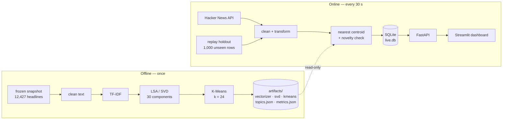

# News Topic Stream

Discover news themes without labels, then apply the frozen model to a live feed.

A K-Means model is trained **once** on a committed snapshot of news headlines. A
separate service loads those saved artifacts **read-only** and assigns every new
headline that arrives from a live API to one of the discovered topics — flagging
the ones that do not fit any of them.

This is the "fixed training data, dynamic execution" pattern: the model never
re-trains while serving, and the live path never fits anything.

---

## The idea in one table

| | Offline (runs once) | Online (every 30 s) |
|---|---|---|
| Data | `data/train_snapshot.csv` — 12,427 headlines, SHA-256 recorded | newest stories from the Hacker News API |
| Code | `src/train.py` → `artifacts/*.pkl` | `src/serve.py` loads artifacts read-only |
| Model | TF-IDF → LSA (SVD) → K-Means fitted here, and only here | `.transform()` + nearest centroid |
| Output | `metrics.json`, `topics.json` | topic, distance, `is_novel` flag, latency |

Nothing in the serving process calls `fit` or `partial_fit`. That separation is
the point of the exercise: a model trained on fixed data has to cope with data
it has never seen, and it has to say so when it cannot.

## Architecture



Two data sources sit behind the same interface, so the demo still works with no
network: `HNLiveSource` polls the real API, `ReplaySource` plays back 1,000
headlines that were deliberately excluded from training.

## Quickstart

Requires Python 3.11+ (developed and tested on 3.14).

```bash
pip install -r requirements.txt
```

Start the API (artifacts are committed, so no training step is needed):

```bash
uvicorn src.serve:app --port 8010
```

Start the dashboard in a second terminal:

```bash
streamlit run dashboard/app.py
```

Open <http://localhost:8501>. New headlines appear every 30 seconds.

**No network?** Use the replay source instead of the live poller:

```bash
python -m scripts.stream_cli --mode replay --interval 0.5
```

Other useful commands:

```bash
python -m src.fetch_snapshot    # re-freeze the dataset (writes the CSV + hash)
python -m src.train             # retrain from the frozen CSV
pytest -q                       # 21 tests, ~5 s, offline
```

## API

| Method | Path | Purpose |
|---|---|---|
| `GET` | `/health` | model loaded, topics, items scored, poller status |
| `GET` | `/topics` | topic labels, keywords, sizes, novelty threshold |
| `POST` | `/predict` | score arbitrary texts: `{"texts": ["..."]}` |
| `POST` | `/ingest` | accept headlines from any external source and store them |
| `GET` | `/recent?limit=50` | newest scored headlines |
| `GET` | `/stats` | totals, novel rate, per-topic counts |
| `POST` | `/poll` | fetch one live batch immediately |

```bash
curl -X POST http://127.0.0.1:8010/predict \
  -H "Content-Type: application/json" \
  -d '{"texts": ["Rust compiler gets faster incremental builds"]}'
```

```json
{"count": 1, "predictions": [{"topic_id": 20, "label": "rust · faster · library",
  "keywords": ["rust", "faster", "library"], "distance": 0.2944, "is_novel": false}]}
```

## Results

Measured on the 1,000 held-out headlines that the model never saw:

| Metric | Value |
|---|---|
| Headlines assigned to a topic | 96.2 % |
| Flagged as novel (beyond p95 distance) | 9.3 % |
| Inference speed | 0.063 ms / headline |
| Topics discovered | 24 |

Clustering quality on the training data (30 SVD components, L2-normalised):

| Metric | Value |
|---|---|
| Silhouette | 0.235 |
| Davies–Bouldin | 1.697 (lower is better) |
| Calinski–Harabasz | 533.6 (higher is better) |
| Vocabulary | 5,673 terms |

A sample of the discovered themes, auto-named from their most characteristic
terms:

```
1262 docs  code · claude · model        440 docs  linux · windows · macos
1062 docs  mcp · api · programming      411 docs  anthropic · ipo · price
 984 docs  llm · google · llms          391 docs  data · center · centers
 956 docs  end · gta · internet         375 docs  security · incident · cyber
 647 docs  browser · web · based        340 docs  rust · faster · library
 538 docs  nvidia · china · trump       258 docs  jensen · huang · nvidia
```

Silhouette of 0.235 is modest, and that is expected: news headlines are eight
words long and real themes overlap. The useful claim is not "we discovered the
true taxonomy" but "a frozen model can route live text into stable, inspectable
buckets and tell you when a headline does not belong".

## Design decisions

**One data source for training and serving.** The frozen snapshot and the live
feed come from the same endpoint. Training on a 1990s corpus and streaming 2026
news would make every assignment look broken; keeping the distributions aligned
is what makes the demo meaningful.

**L2-normalise after SVD.** Training clusters normalised SVD vectors. When the
serving code originally skipped that step, 36 of 40 unrelated live headlines
collapsed into a single cluster, because every vector sat near the origin and
the nearest centroid won by default. Normalising makes Euclidean distance behave
like cosine and keeps clusters balanced (largest topic: 10 % of documents).

**c-TF-IDF for topic names.** Ranking keywords by mean TF-IDF lets a single rare
story name a 1,500-document cluster ("riemann · hypothesis"). c-TF-IDF scores
*term frequency inside the cluster × how exclusive the term is to that cluster*,
which produces names like `nvidia · china · trump` instead.

**Novelty instead of forced assignment.** Every training point's distance to its
own centroid is recorded; the 95th percentile becomes a threshold. A live
headline beyond it is returned as `is_novel: true` with its distance exposed, so
a human can see that the frozen model is being stretched. This is the honest
answer to "what about topics that did not exist in training data?" — the model
cannot discover them, but it can refuse to pretend.

**No retraining at runtime.** Drift detection and incremental learning are
deliberately out of scope: the brief requires fixed training data. Documented
under future work.

**Frequency filtering instead of hand-tuned stopwords.** `max_df=0.05` removes
words that appear in more than 5 % of headlines, which is what eliminated
generic filler such as `new`, `open source` and `read` without curating a list.

## Repository layout

```
news-topic-stream/
├── data/
│   ├── train_snapshot.csv      # frozen training data (committed)
│   ├── replay_holdout.csv      # 1,000 unseen rows for offline demos
│   └── snapshot_meta.json      # source, timestamps, SHA-256
├── artifacts/                  # fitted objects, committed for reproducibility
│   ├── vectorizer.pkl  svd.pkl  kmeans.pkl
│   ├── topics.json             # labels, keywords, sizes
│   └── metrics.json            # all numbers quoted above
├── src/
│   ├── config.py               # paths, hyper-parameters, SEED
│   ├── preprocess.py           # cleaning + vectorisers (shared by both stages)
│   ├── fetch_snapshot.py       # freezes the dataset
│   ├── train.py                # offline stage
│   ├── predict.py              # ArtifactBundle: load once, score many
│   ├── ingest.py               # the single "new data meets frozen model" path
│   ├── db.py                   # SQLite sink
│   ├── serve.py                # FastAPI service + background poller
│   └── sources/
│       ├── hn_live.py          # live API poller
│       └── replay.py           # offline fallback stream
├── dashboard/app.py            # Streamlit live dashboard
├── scripts/stream_cli.py       # terminal stream (demo backup)
├── notebooks/01_eda_and_training.ipynb
└── tests/                      # pipeline + API tests
```

## Dataset

Hacker News story titles via the public Algolia API
(`https://hn.algolia.com/api/v1/search_by_date`). No API key, no authentication.
`python -m src.fetch_snapshot` re-creates the exact file; `src/train.py` verifies
its SHA-256 against `data/snapshot_meta.json` and warns if it has changed.

Only titles, URLs and timestamps are stored — no comments, no user identifiers.
Titles are public content used here for a course exercise. The model must not be
used to make moderation or editorial decisions about real publications.

## Limitations

- Titles only (~8 words), so signal is thin; accuracy on genuinely ambiguous
  headlines is limited.
- Clusters are unlabelled by nature. Names are keyword summaries, not ground
  truth.
- 30 SVD components retain ~7 % of TF-IDF variance. Enough to cluster well, but
  it is a lossy representation.
- Short out-of-domain text can still be assigned if its distance stays under the
  threshold. Distance is always returned so the caller can judge.
- English only; no stemming or lemmatisation; no entity recognition.
- No drift detection, no incremental learning, no re-training loop.

## Future work

1. **Drift monitoring** — track the distance distribution over time and raise an
   alert when the novel rate climbs, then trigger an offline retrain.
2. **Incremental clustering** — `MiniBatchKMeans.partial_fit` on a rolling window
   would let new themes emerge, at the cost of reproducibility.
3. **Better representations** — sentence embeddings would likely beat TF-IDF on
   eight-word titles.
4. **Human-in-the-loop naming** — let a user rename a cluster and persist it.

## Reproducibility

- `SEED = 42` in `src/config.py`, used by SVD and K-Means.
- Versions pinned in `requirements.txt`; pickles are not portable across
  scikit-learn versions.
- The training CSV is committed and hash-checked, so "fixed data" is literally
  fixed.
- `python -m src.train` is deterministic: same snapshot + same seed + same
  versions ⇒ same artifacts.

## Tests

```bash
pytest -q
```

21 tests covering text cleaning, artifact round-tripping, prediction alignment,
empty/unknown input handling, the novelty flag, SQLite idempotency and recovery,
the ingest path, and every API endpoint. The API tests disable the live poller,
so the suite runs fully offline.
